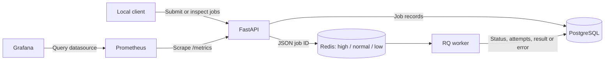

# QueueOps

QueueOps is a local background job service built with Python 3.12, FastAPI,
PostgreSQL, Redis and RQ. It separates HTTP submission from task execution,
records each job's lifecycle, and exposes service health and request metrics
through Prometheus and Grafana.

The project demonstrates practical backend and operations concerns: queue
priorities, asynchronous processing, failure visibility, bounded manual retries,
container startup dependencies, and repeatable integration checks. It is a
portfolio prototype for trusted local development, with explicit limits around
security and delivery guarantees.

## What is implemented

- Typed job submission, task-specific payload validation, paginated job listing,
  and status/result lookup.
- Three Redis priority queues consumed by an RQ worker using JSON serialization.
- PostgreSQL records for status, execution attempts, results, errors and timestamps.
- Manual retries for failed jobs, with a three-attempt ceiling in sequential use.
- Liveness/readiness endpoints, Prometheus HTTP/submission metrics, and a
  provisioned Grafana datasource.
- A non-root application image, Docker Compose stack, Pytest coverage, and a
  GitHub Actions workflow configured for Python 3.12 pushes and pull requests.

No authentication, authorization, rate limiting or TLS is provided. Keep all
published ports on `127.0.0.1`; this stack is not configured for public deployment.

## Architecture and job flow



1. The API validates a job, saves a `queued` record, and enqueues its ID.
2. The worker checks `high`, `normal`, then `low` queues, marks the job `running`,
   increments its attempt count, and executes the selected task.
3. The worker records `completed` with a result or `failed` with an error. The
   client can inspect the record and request a retry. An enqueue failure is
   recorded as `queue_error`.

The API and worker share database and Redis configuration. PostgreSQL and Redis
writes are separate operations; this is not transactional or exactly-once
processing. Sustained high-priority traffic can starve lower-priority queues.

## Run locally

Requirements: Docker Desktop with Docker Compose v2, plus Python 3.12 for host
checks and the integration/demo scripts. Run commands from the project root.

```sh
test -f .env || cp .env.example .env
chmod 600 .env
# For a NEW installation, edit .env and replace both password placeholders.
# For an EXISTING installation, keep the current credentials and project name.
docker compose config --quiet
docker compose up -d --build --wait
docker compose ps
curl --fail http://127.0.0.1:8000/ready
```

The ignored `.env` supplies PostgreSQL and Grafana credentials. Never copy
placeholder passwords over an existing configuration. Changing
`POSTGRES_PASSWORD` does not change the password inside an initialized database
volume. Grafana's admin variables likewise initialize a new Grafana database and
may not reset an existing account. Do not delete volumes to resolve a mismatch.

Keep the existing `COMPOSE_PROJECT_NAME`, PostgreSQL username and database name.
The default project `queueops` uses `queueops_postgres_data`,
`queueops_grafana_data`, and `queueops_prometheus_data`. Stop any host-run API or
worker before starting Compose to avoid port conflicts and duplicate consumers.

| Service | Local address | Purpose |
| --- | --- | --- |
| API / OpenAPI | http://127.0.0.1:8000/docs | Submit and inspect jobs |
| API liveness | http://127.0.0.1:8000/health | Process-level health |
| API readiness | http://127.0.0.1:8000/ready | PostgreSQL query and Redis PING |
| Prometheus | http://127.0.0.1:9090 | Query metrics and inspect scrape targets |
| Grafana | http://127.0.0.1:3000 | Explore the provisioned Prometheus datasource |
| PostgreSQL | 127.0.0.1:5432 | Local database tools |
| Redis | 127.0.0.1:6379 | Local queue tools |

## Submit and inspect a successful job

```sh
curl --fail -X POST http://127.0.0.1:8000/jobs \
  -H 'Content-Type: application/json' \
  -d '{"job_name":"demo","task_type":"sum_numbers","payload":{"numbers":[10,20,30]},"priority":"high"}'

curl --fail 'http://127.0.0.1:8000/jobs?limit=20&offset=0'
```

The submission response includes `job_id`; use `GET /jobs/{job_id}` to inspect
its final result. The sum above completes with `{"total":60}` inside `result`.

| Task | Payload |
| --- | --- |
| `uppercase_text` | `{"text":"hello"}` |
| `sum_numbers` | `{"numbers":[10,20,30]}` |
| `generate_report` | `{"items":["alpha","beta"]}` |
| `simulate_failure` | `{}`; deliberately raises an error |

## Demonstrate failures and retries

With the stack running, this Python standard-library example creates one
intentional failure, waits for each attempt, retries it twice, and verifies that
a further retry returns HTTP 409. It retains the demo record and makes no AI
requests. No `jq` or additional Python packages are required.

```sh
python3.12 - <<'PY'
import json
import time
from urllib.error import HTTPError
from urllib.request import Request, urlopen

base = "http://127.0.0.1:8000"
def api(path, data=None):
    body = None if data is None else json.dumps(data).encode()
    request = Request(base + path, data=body,
                      headers={"Content-Type": "application/json"})
    with urlopen(request, timeout=10) as response:
        return json.load(response)

job = api("/jobs", {"job_name": "retry-demo",
                    "task_type": "simulate_failure", "payload": {}})
path = "/jobs/" + job["job_id"]
print("Job:", job["job_id"])
for attempt in range(1, 4):
    if attempt > 1:
        api(path + "/retry", {})
    deadline = time.monotonic() + 30
    while time.monotonic() < deadline:
        job = api(path)
        if job["status"] == "failed" and job["attempts"] == attempt:
            print("Failed attempt:", attempt)
            break
        time.sleep(0.5)
    else:
        raise RuntimeError("Worker did not reach the expected failed state")
try:
    api(path + "/retry", {})
except HTTPError as error:
    assert error.code == 409, error.code
    print("Retry limit enforced: HTTP 409")
else:
    raise RuntimeError("Expected the retry limit to reject another attempt")
PY
```

Retries are manual through `POST /jobs/{job_id}/retry`. No automatic retry,
backoff, dead-letter recovery or concurrency-safe retry claim is implemented.

## Tests and integration verification

```sh
test -d .venv || python3.12 -m venv .venv
. .venv/bin/activate
python -m pip install -r requirements-dev.txt
python -m pip check
python -m pytest -v
python -m py_compile app/main.py app/worker.py scripts/verify_stack.py
docker compose config --quiet
# Requires the running local stack; creates and retains two demo job records:
python scripts/verify_stack.py
```

The 13 automated tests cover API/processing behavior and incident-redaction
cases using SQLite, fake queues and mocked provider calls. The integration
script separately checks real PostgreSQL/Redis readiness, JSON worker processing,
failed jobs, the sequential three-attempt ceiling, a fresh Prometheus scrape,
and Grafana-to-Prometheus connectivity. It never calls OpenAI.

Local review verified all 13 tests, a fresh Python 3.12 dependency installation,
a Linux ARM64 container build, and the integration checks above. The dependency
audit found no known advisories in 42 resolved packages at review time. These are
point-in-time checks; transitive dependencies and image digests are not fully
locked. See the [readiness review](docs/readiness-review.md) for evidence and scope.

The GitHub Actions workflow installs dependencies, runs all tests, compiles source
and validates Compose using CI-only placeholders. It has read-only repository
permissions and no production credentials. The first
[GitHub-hosted run passed all 13 tests](https://github.com/YourNoob-web/QueueOps/actions/runs/43797335902),
plus dependency, compilation and Compose validation checks.

## Observability and operations

Prometheus scrapes `api:8000/metrics` on the Compose network. Grafana uses
`http://prometheus:9090`; sign in with the local Grafana credentials and select
**Prometheus** in Explore. Example queries:

- `queueops_jobs_submitted_total`
- `queueops_http_requests_total`
- `rate(queueops_http_request_duration_seconds_sum[5m])`

No Grafana dashboard, alerts, worker execution metrics or queue-depth metrics
are supplied.

```sh
docker compose logs --tail=100 api worker
docker compose stop
# Remove containers/network while preserving named data volumes:
docker compose down
```

Redis has no persistent volume. Replacing/removing its container can lose queue
state while PostgreSQL job records remain. `stop` retains the current containers;
`down` removes them. Never use `docker compose down -v` for routine operation.
Do not share `.env`, unredacted logs, or resolved `docker compose config` output;
use `--quiet` for validation because resolved configuration contains credentials.

## Optional incident analysis

The core queue service works with `OPENAI_API_KEY` empty, as in `.env.example`.
An optional `/incidents/analyze` endpoint can send selected failure details to
OpenAI for advisory text when a key is configured on the API. Without a key it
returns HTTP 503. Live provider behavior is **unverified**; no paid AI requests
were made during review. Analysis neither executes commands nor repairs systems.

Leave the key unset unless you choose to enable this feature. Requests can incur
cost, and redaction is best effort. Never supply credentials, private logs,
personal data or regulated information. Only the API receives the optional key;
the worker does not. See [security guidance](SECURITY.md).

## Limits and future work

This is a local prototype without tenant isolation or production availability
guarantees. Simultaneous retries and worker crashes can cause duplicate execution,
stale state or attempts beyond the intended sequential ceiling. Avoid tasks with
non-idempotent real-world side effects.

Concurrency-safe claims, idempotency, transactional outbox/reconciliation,
persistent queue recovery, schema migrations, authentication and deeper worker
observability are future work. Kubernetes, Terraform, AWS deployment, autoscaling,
automated remediation and load-test benchmarks are not implemented or claimed.
See [architecture](docs/architecture.md) for failure semantics and tradeoffs.
