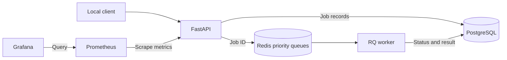
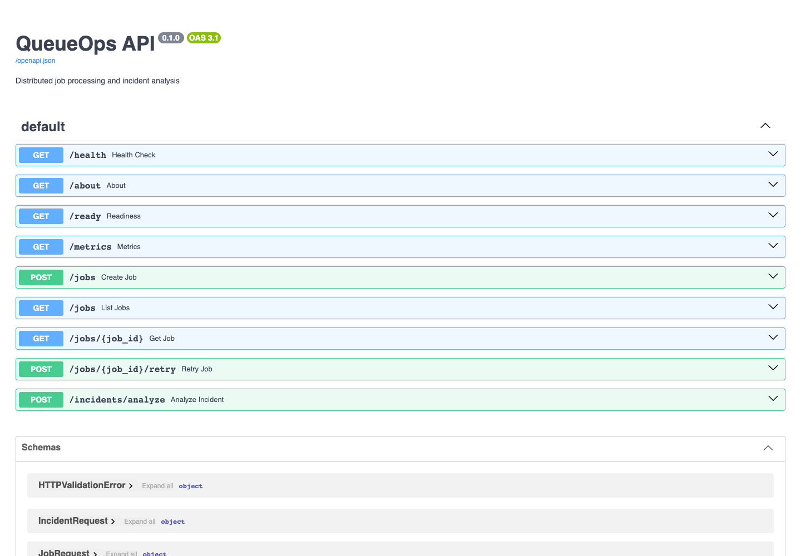
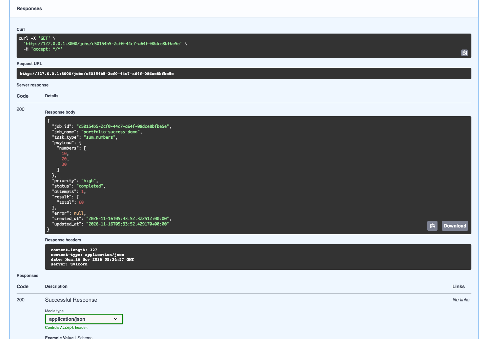
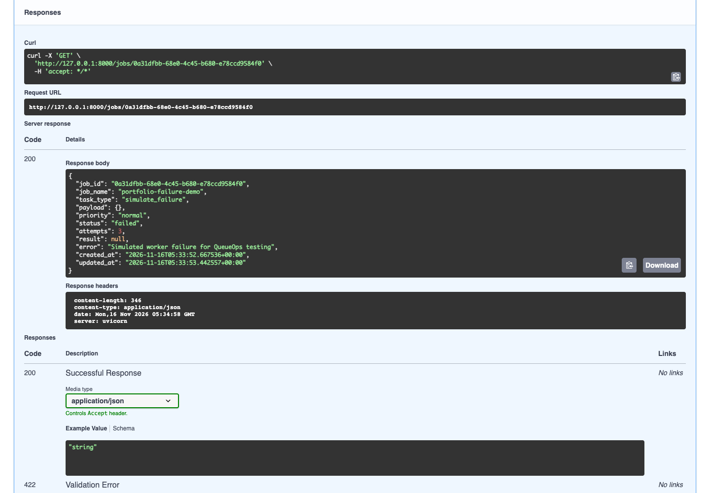
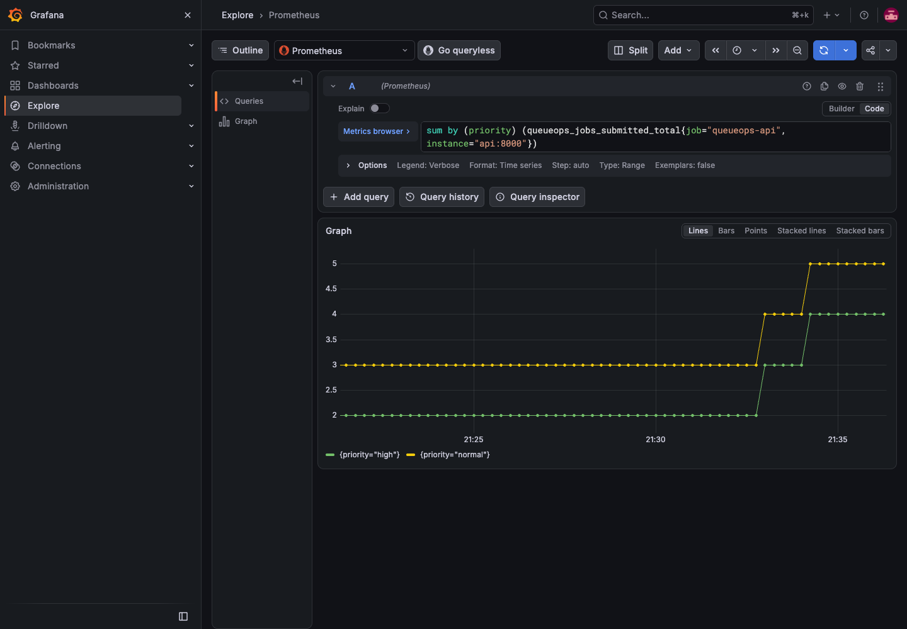

# QueueOps

**Asynchronous job processing with observable infrastructure.** A Python/FastAPI
service that moves work out of HTTP requests and tracks execution in PostgreSQL.
Redis and RQ handle priority queues; Prometheus and Grafana make the API observable.

## Technology stack

| Layer | Technologies |
| --- | --- |
| API | Python 3.12, FastAPI, Pydantic |
| State and execution | PostgreSQL, Redis, RQ with JSON serialization |
| Infrastructure | Docker Compose: six services, non-root API/worker |
| Observability | Prometheus metrics, Grafana datasource and Explore |
| Verification | Pytest, integration script, GitHub Actions |

## Architecture



- Typed submission, payload validation, paginated listing and job inspection.
- Four task types; three queues checked in `high`, `normal`, `low` order.
- Lifecycle: `queued` → `running` → `completed`/`failed`; enqueue errors become `queue_error`.
- Manual retries capped at three execution attempts in sequential use.
- `/health`, PostgreSQL/Redis `/ready`, HTTP/submission metrics and repeatable failure checks.

See [architecture and failure semantics](docs/architecture.md).

## Real screenshots

Captured from the running local stack using synthetic demo jobs and actual metrics.
Grafana shows Explore; no saved dashboard or alerts are shipped.

| API documentation | Completed background job |
| --- | --- |
|  |  |
| Failed job after three attempts | Grafana Explore with live API metrics |
|  |  |

[Screenshot details](docs/demo.md#screenshots).

## Run locally

Requires Docker Desktop/Engine with Compose v2. Python 3.12 is needed only for
host tests and verification scripts; the containers include the application runtime.

```sh
git clone https://github.com/YourNoob-web/QueueOps.git
cd QueueOps
test -f .env || cp .env.example .env
chmod 600 .env
# New install: edit .env and replace BOTH password placeholders.
docker compose config --quiet
docker compose up -d --build --wait
curl --fail http://127.0.0.1:8000/ready
```

Existing installations must preserve credentials and `COMPOSE_PROJECT_NAME`.
Changing environment passwords does not update initialized database accounts.
The API creates missing tables on startup; no separate migration command is needed.
Stop host-run API/workers before starting Compose to avoid conflicts.

| Interface | Local URL |
| --- | --- |
| API / Swagger | http://127.0.0.1:8000/docs |
| Prometheus | http://127.0.0.1:9090 |
| Grafana | http://127.0.0.1:3000 — use local `.env` credentials |

## Try a job

```sh
curl --fail http://127.0.0.1:8000/jobs \
  -H 'Content-Type: application/json' \
  -d '{"job_name":"demo","task_type":"sum_numbers","payload":{"numbers":[10,20,30]},"priority":"high"}'
```

Fetch `/jobs/{job_id}` using the returned ID; the worker produces `{"total":60}`.
For an intentional failure, submit `task_type: "simulate_failure"` with `payload: {}`.
After it reaches `failed`, POST `/jobs/{job_id}/retry` to retry manually.
The [runnable walkthrough](docs/demo.md) demonstrates three failures and the HTTP 409 retry ceiling.
Other tasks: `uppercase_text` and `generate_report`.

## Tests and monitoring

```sh
test -d .venv || python3.12 -m venv .venv
. .venv/bin/activate
python -m pip install -r requirements-dev.txt
python -m pip check
python -m pytest -v
# With the stack running; retains two demo records, no paid API calls:
python scripts/verify_stack.py
```

**13 tests pass** with SQLite/fake queues/mocked provider calls. Live integration
separately verifies PostgreSQL, Redis/RQ, failure/retry behavior and monitoring.
[GitHub Actions](https://github.com/YourNoob-web/QueueOps/actions/workflows/tests.yml)
checks Python 3.12 tests, dependencies, compilation and Compose on pushes/PRs.

In Grafana Explore, select **Prometheus** and query `queueops_jobs_submitted_total`
or `queueops_http_requests_total`.

## Operations and limits

Use `docker compose ps` and `docker compose logs --tail=100 api worker` to inspect
services. `docker compose stop` retains containers. `docker compose down` preserves
named volumes but removes containers; Redis queue state can be lost. Never use
`down -v` for routine cleanup or credential recovery.

Keep ports on localhost: there is no authentication, TLS, rate limiting or tenant
isolation. Concurrent retries are not atomic; crashes can leave stale records.
There is no durable Redis storage, transactional outbox, schema migration system,
worker metrics, autoscaling or production availability guarantee.

Leave `OPENAI_API_KEY` empty; the optional incident endpoint is not required and
has not been verified live. AWS/Kubernetes deployment and automated remediation
are not implemented.
Read [security guidance](SECURITY.md) before sharing logs or exposing services.
