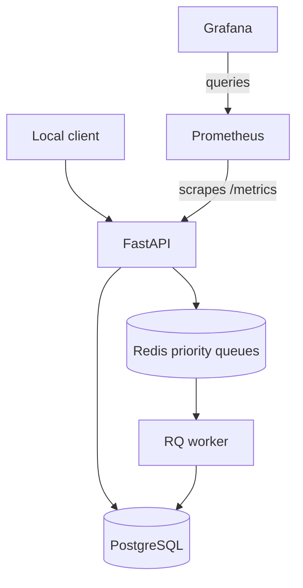

# Architecture

The API validates a task, writes a PostgreSQL job record, and enqueues its ID in
one of three Redis queues. The RQ worker consumes JSON-serialized jobs and writes
status, attempt count, result or error to PostgreSQL. PostgreSQL is the job-state
store; Redis holds queue state. These two writes are not a single transaction.
Redis has no persistent volume in this local Compose stack: replacing/removing
its container can lose queue state while PostgreSQL records remain. Durable
queue storage and recovery/reconciliation are future work.

Compose uses its default service network for container-to-container traffic.
Only loopback ports are published to the host; outbound access is not disabled.
The worker starts after the API readiness check; the API lifespan creates missing
tables. This is a prototype schema initialization strategy, not a migration
system. There is no Alembic history yet.

## Observability

`/health` is a process-level liveness check. `/ready` executes a database query
and pings Redis. Prometheus scrapes the API's `/metrics`; Grafana provisions the
Prometheus datasource. Application metrics cover HTTP count/latency and accepted
job submissions. Worker execution metrics, queue-depth dashboards and alerts are
not implemented.

## Failure semantics

A successful database insert followed by an enqueue failure becomes `queue_error`.
A worker exception produces `failed` and is re-raised to RQ. The retry endpoint
accepts failed/queue-error jobs until three attempts have been recorded.

There is no transactional outbox, reconciliation loop, idempotency key, or
concurrency-safe claim on a job record. A process crash or simultaneous retry
requests can leave stale state, duplicate execution, or exceed the intended
attempt ceiling. The sequential retry limit is tested; stronger concurrent
semantics are future work. Do not use tasks with non-idempotent real-world side
effects until these guarantees are designed and tested.

The optional incident analyzer transmits selected failure details to OpenAI and
returns advisory text. It does not execute repairs, inspect infrastructure on its
own, or establish a cause with certainty.
